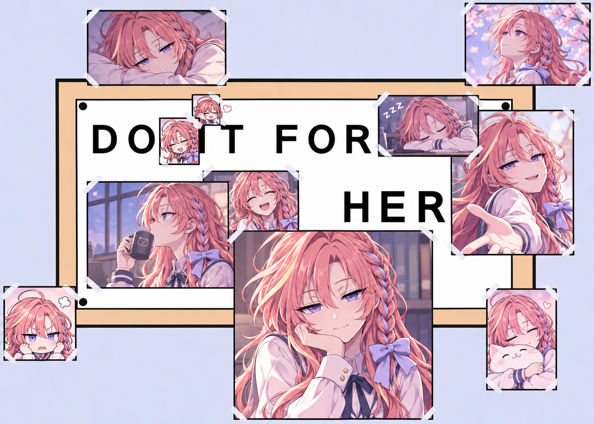

# Rielle

## V0.01: 2D design, voice design and basic LLM

November 13, 2026

# Future plans:

### LLM

- LLM identity, personality, character, emotions
- Decision making, preference, emotions
- Initiative to start conversation

### Memory

- Short term conversation memory
- Long term memory
- Recalls past conversation

### Voice

- STT and TTS
- Voice consistency and reply speed, efficiency
- Emotion, intensity, pace, delivery
- Vocal expressions like laughing
- English subtitles on screen because I don't speak Japanese
- Text messaging ( phone font :o )

### Design

- Finish 3D base model
- Facial expressions
- Body movements and animations
- Interactive animations tap head => animation
- Outfits and hair styles ( so much 3d work :c )

### Vision

- CV
- Gesture recognition => reply or animations
- Screen viewing
- Read text on screen

### Personal world

- 3D world for Rielle
- Free movement
- Object, furniture interactions
- ^read a book, sleep, cook, instrument, etc
- World simulation <- Routines, dynamic world, NPC?
- Planning actions <- "I want to make some tea" => go to kitchen => find cup => make tea

### Other stuff

- Connect to cloud AI for more demanding tasks
- Connect everything into a single app
- Other characters(Not anytime soon because I have no money :heart_broken:)
- Speed and VRAM efficiency
- Get money for better hardware
- AGI can't come any sooner to make her real
- Use my CSE degree to make physical body

 

##### about to learn every single skills to make this work :tf:

